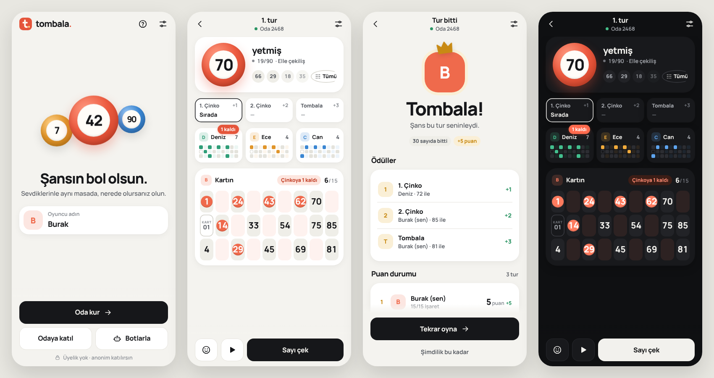

# tombala.

2–4 kişilik, Türkçe, ailece oynanan çevrimiçi tombala. Sıfırdan HTML, CSS ve JavaScript; derleme veya arayüz çatısı gerektirmez.



## Oyun

- Firebase Authentication ile otomatik anonim giriş.
- Transaction ile ayrılan dört haneli oda kodu ve dört koltuk.
- Lobide rastgele kart, üç kart arasından seçim veya kendi kartını oluşturma.
- Dönüşümlü 3×10 kart: ilk ve üçüncü satır sayı/boş, ikinci satır boş/sayı. Sütunlar sırasıyla 2 ve 1 sayı taşır; her satırda 5, toplam 15 benzersiz sayı bulunur. 10. sütun 90 sayısına ayrılır.
- Herkes hazırsa oda sahibi başlatır. Sayıları elle veya beş saniyede bir otomatik çeker.
- Sayılar otomatik işaretlenir; 1. çinko, 2. çinko ve tombala otomatik hesaplanır. Aynı çekilişte bitirenler birlikte kazanır.
- “Tekrar oyna” aynı odanın lobisine döndürür. Herkes yeniden hazır olmalıdır.
- Bağlantı kesilince çevrimdışı durumu; kalan oyuncunun oda sahipliğini devralabilmesi; sayfa yenilemede oturuma dönüş.
- Tam ekran mobil oyun kabuğu: sabit üst çubuk, altta başparmak erişimli ana aksiyonlar, yatay oyuncu listesi, çekiliş sahnesi ve alttan açılan kart/sayı çekmeceleri. PNG uygulama ikonlarıyla ana ekrana eklemeye uygun manifest.

## İlk kurulum: Firebase kurallarını yayımla

Telefondan: oyunun yayımlandığı adreste `kurulum.html` sayfasını aç. “Kuralları kopyala” düğmesine dokun, Firebase panelinde Realtime Database → Kurallar bölümündeki metni değiştirip yayımla ve kurulum sayfasına dön. Son adımdaki kontrol yalnızca anonim giriş ve oda okuma iznini sınar; yazma izni oyunda oda oluştururken doğrulanır. Kurulum ekranı herhangi bir oda oluşturmaz ve Firebase'e yönetici olarak giriş yapmaz.


`firebase-config.js`, mevcut `tombala-3d421` projesinin herkese açık web yapılandırmasını içerir. Web API anahtarı bir yönetici parolası değildir. Erişimi veritabanı kuralları sağlar.

**Yeni 3×10 kart sürümü `tombalaV3` yolunu kullanır; eski 3×9 odalarla karışmaması için odalar yeniden kurulmalıdır. Eski kurallar bu yolu kapattığından aşağıdaki kurallar dağıtılmadan çevrimiçi oda kurulamaz.**

```sh
npm install
npx firebase login
npx firebase deploy --only database --project tombala-3d421
```

Alternatif: Firebase Console → Realtime Database → Rules bölümüne `database.rules.json` içeriğini yapıştırıp Publish seç.

Firebase Console → Authentication → Sign-in method → Anonymous açık olmalı. Mevcut projede anonim giriş tarayıcıdan doğrulandı. Uygulama farklı bir projeye taşınırsa yapılandırmayı ve `.firebaserc` dosyasını değiştir.

Kurallar oda listesini kapatır, oda kodu bilen oturumlara okumayı açar, koltuk sayısını dört ile sınırlar, diğer oyuncunun kartına yazmayı ve oyun esnasında kart değiştirmeyi engeller. Çekilişi ve sonuçları oda sahibi yönetir; bu aile oyunu için güvenilen istemcidir. Rekabetçi/ödüllü kullanım için sunucu tarafında hakem gerekir.

Odalar altı saat geçerli. Süresi dolan kayıtlar kodu yeniden kullanmamak için otomatik üzerine yazılmaz. Uzun vadede zamanlanmış bir yönetici göreviyle eski `tombalaV3` kayıtları temizlenebilir.

## Yayınlama

Dosyaları herhangi bir statik sunucuda veya GitHub Pages üzerinde repo kökünden yayımla. `index.html` dosyasını `file://` ile açma: JavaScript modülleri HTTP(S) ister. Node, npm ve test bağımlılıkları son kullanıcı için gerekli değildir. Firebase SDK ve yazı tipleri CDN üzerinden yüklenir; yazı tipleri yüklenemezse sistem yazı tipi kullanılır.

Yerel geliştirme:

```sh
python3 -m http.server 8080
```

`http://localhost:8080/` gerçek Firebase bağlantısını kullanır. `?demo=1` yalnızca tasarım denemesi içindir; iki örnek oyuncuyla tarayıcı belleğinde oynanır ve Firebase odası oluşturmaz.

## Doğrulama

Node.js 22 ve Java 21 önerilir.

```sh
npm install
npm run check
npm test
npm run test:database
```

Oyun testleri örnekteki dönüşümlü düzeni, sütun başına 2/1 sayı kuralını, 1.000 geçerli kartı, 100 tam turu, oyuncu/hazır sınırlarını, birlikte kazanmayı ve tekrar lobiye dönüşü doğrular. Firebase Emulator testleri gerçek veritabanı kurallarını; oturumsuz erişimi, kod ve koltuk çakışmalarını, beşinci oyuncuyu, kart kilidini, eski kart biçiminin ve yanlış boşlukların reddini, oda sahibi devrini ve yeni turu sınar. Emülatör testleri `demo-tombala` projesinde çalışır, canlı veritabanına yazmaz.

Önizleme: `?demo=1&scene=lobby`, `?demo=1&scene=game` ve `?demo=1&scene=results` yalnızca bellekte örnek veriyle ilgili ekranı açar.
